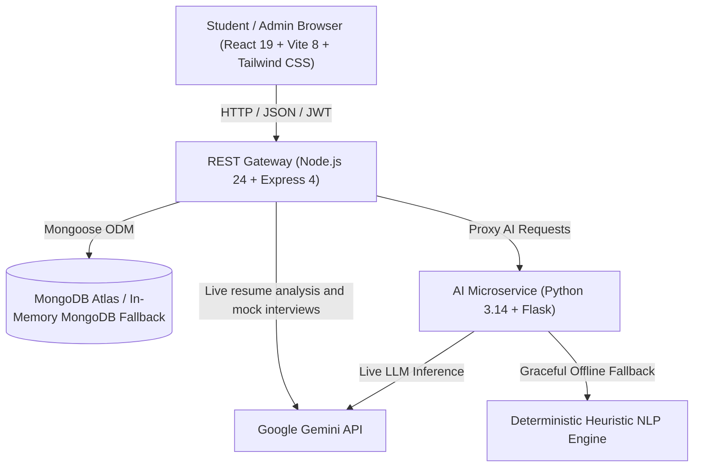

# AI-Powered Placement Preparation & Career Guidance Portal
> **Final-Year Computer Engineering Capstone Project**  
> A modern, full-stack, AI-driven recruitment preparation and campus placement governance platform.

---

## 🌟 Executive Summary
The **AI-Powered Placement Preparation & Career Guidance Portal** is a production-grade web platform engineered to bridge the gap between academic curriculum and high-tier software engineering hiring benchmarks (Google, Microsoft, Amazon, TCS Digital, Goldman Sachs).

It empowers **Students** with automated ATS resume scans, interactive AI mock technical/behavioral interviews, timed aptitude mastery tests, an isolated code sandbox for DSA problem solving, and personalized 12-week roadmaps. Simultaneously, it equips **Placement Officers / Admins** with a centralized command center to orchestrate placement drives, enforce CGPA and branch eligibility rules, monitor cohort preparedness indexes, and broadcast campus notices.

---

## 🏗️ Multi-Tier System Architecture



### Technology Stack
- **Frontend**: React 19, Vite 8, Tailwind CSS v4, Lucide React, Recharts, Canvas Confetti.
- **Backend API**: Node.js v24, Express.js 4, Mongoose 8, JWT, BcryptJS, Multer, PDF-Parse, Express Rate Limit.
- **Database Resilience**: Connects to external MongoDB (`MONGO_URI`) or automatically boots an embedded in-memory MongoDB server via `mongodb-memory-server` if local MongoDB is offline.
- **AI Microservice**: Python 3.14 Flask service with hybrid Gemini 1.5 Flash API connector and deterministic NLP heuristic algorithms.
- **Code Execution**: Node.js `vm` isolated sandbox with timeout and memory constraints (strictly preventing execution of arbitrary OS shell commands).

---

## 👥 User Roles & Seeded Demo Accounts

The database is pre-seeded with realistic student records, company listings, active job drives, aptitude questions, and DSA challenges:

| Role | Email | Password | Access Capabilities |
| :--- | :--- | :--- | :--- |
| **Student** | `student@placement.edu` | `Student@123` | Dashboard, Resume Analyzer, Mock Interview, Aptitude, Coding, Career, Jobs, Planner, Analytics |
| **Admin** | `admin@placement.edu` | `Admin@123` | Student Directory, Placement Drives, Applications Pipeline, Company Management, Question Bank |

*(Both accounts are pre-filled on the Login screen via 1-click quick-fill buttons).*

---

## 📦 Modules & Capabilities

### 1. Student Modules
1. **Executive Dashboard**: Real-time Preparation Readiness Index (0-100% radial gauge), academic stats (CGPA 8.75), upcoming placement drives countdown, recommended preparation tasks, and live activity timeline.
2. **AI Resume Analyzer**: Click or drop a text-based PDF or UTF-8 TXT resume (up to 5MB), or paste resume text. Gemini reviews the actual content and returns strengths, prioritized issues with evidence, section feedback, truthful bullet rewrites, and an explained score breakdown. Adding a job description enables requirement matching; no match score is generated without one. Reports are saved for later review, and the analysis screen uses smooth animations and rotating short tech quotes with reduced-motion support.
3. **AI Mock Interview Room**: Live Gemini questions tailored to a target engineering role, technical or HR round, difficulty, and question count (1–10). Accepts typed answers or microphone speech dictation (Web Speech API), evaluates the actual content of each answer, and saves feedback, ideal answers, and a question-by-question result report. Provider failures are shown as errors; interviews do not use fixed questions or offline grading.
4. **Aptitude Practice Engine**: Timed speed drills across Quantitative Aptitude, Logical Reasoning, and Verbal Ability with real-time countdown timer, radio options, automatic scoring, and detailed step-by-step mathematical explanations.
5. **Coding Sandbox (DSA)**: Curated placement challenge catalog (Easy, Medium, Hard). Split-view workspace featuring problem description, constraints, hints, code editor supporting JavaScript, Python, C++, and Java, and an isolated timeout sandbox runner (1500ms safety limit).
6. **AI Career Guidance**: Dynamic 12-week strategic preparation milestones, skill-gap analysis, recommended capstone projects, and curated learning resources.
7. **Placement Drive Portal**: Active company listings with CTC packages, automatic CGPA and branch eligibility indicators, one-click application modal, and application status pipeline tracker.
8. **Study Planner**: Daily and weekly preparation task checklist with priorities (High, Medium, Low), due dates, and completion progress bar.
9. **Analytics**: Interactive Recharts displaying interview competency radar, aptitude accuracy by domain, DSA problems solved vs target, and score trajectories over time.

### 2. Admin Module
1. **Cohort Overview**: Aggregate statistics for total candidates, companies, active drives, total applications, and cohort average CGPA.
2. **Student Directory**: Searchable, filterable candidate database with roll numbers, branch filters, and preparation scores.
3. **Drives & Jobs Manager**: Create new campus placement listings with CTC, allowed branches, minimum CGPA, and application deadlines.
4. **Applications Pipeline**: Review candidate submissions and transition statuses (Applied, Shortlisted, OA Scheduled, Selected, Rejected) with feedback notes.
5. **Question Bank Manager**: Add new questions to the Aptitude question bank with multiple choices, correct answer keys, and derivations.
6. **Broadcaster**: Publish announcements and urgent campus placement notices.

---

## 🚀 Windows Installation & Run Instructions

### Prerequisites
- **Node.js**: v18.0.0 or higher (`node -v`)
- **Python**: v3.9 or higher (`python --version`)

### Quick 1-Click Startup (Recommended)
Double-click `start-all.bat` (or run `start-all.ps1` in PowerShell) in the root directory:
```powershell
.\start-all.ps1
```
This automatically boots all 3 services in separate terminal windows.

---

### Manual Step-by-Step Startup

#### Terminal 1: Python AI Microservice
```powershell
cd ai-service
pip install -r requirements.txt
python app.py
```
> Running on: `http://localhost:5001`

#### Terminal 2: Node.js Express REST Backend
```powershell
cd backend
npm install
npm start
```
> Running on: `http://localhost:3000`
> *(If local MongoDB is not running, the backend seamlessly launches an in-memory MongoDB instance).*

#### Terminal 3: React Vite Frontend
```powershell
cd frontend
npm install
npm run dev
```
> Running on: `http://localhost:5173`

---

## 🔑 Environment Variables Configuration

### Backend (`backend/.env`)
```env
PORT=3000
NODE_ENV=development
MONGO_URI=mongodb://127.0.0.1:27017/placement_portal
JWT_SECRET=ai_placement_portal_super_secret_jwt_key_2026
JWT_EXPIRES_IN=7d
CLIENT_URL=http://localhost:5173
AI_SERVICE_URL=http://127.0.0.1:5001
GEMINI_API_KEY=your_google_ai_studio_key
GEMINI_MODEL=gemini-3.5-flash-lite
```

Resume analysis and mock interviews call Gemini directly from the Node backend, so these features do not require the Python service. Keep `GEMINI_API_KEY` only in the ignored `backend/.env` file and restart the backend after changing it. Never put the key in frontend code or a `VITE_*` variable. Create a key in [Google AI Studio](https://aistudio.google.com/api-keys); the API project must have access and available quota for the configured model.

Resume uploads accept PDF and UTF-8 TXT files up to 5 MB, or 50–30,000 characters of pasted text. The optional job description supports up to 15,000 characters. Scanned/image-only PDFs require OCR or pasted text. The overall resume score is the mean of four AI-assessed dimensions: text readability, demonstrated skills, evidenced impact, and relevant completeness. This is an assessment of extracted text, not a commercial ATS test or visual PDF-layout inspection. Reports do not change profile skills automatically. Provider failures preserve the input for retry and never substitute a canned report.

The interviewer generates the requested question set once, then grades each submitted answer against that question's private assessment rubric. The answer score weights relevance/accuracy at 50%, depth/completeness at 30%, and clarity at 20%. The final result is the mean of the answered question scores. For HR rounds, relevance and behavioral evidence replace technical accuracy. Feedback and complete results are available in interview history. If Gemini times out, rejects the key, or runs out of quota, the app keeps the current answer available for retry instead of substituting dummy results.

### AI Service (`ai-service/.env`)
```env
PORT=5001
# Optional: Add Google Gemini API Key for live LLM inference.
# If omitted, the service runs its deterministic heuristic NLP engine.
GEMINI_API_KEY=
OPENAI_API_KEY=
```

---

## 🧪 Automated Testing Verification

The backend includes automated checks for authentication, sandbox timeouts, real PDF extraction, upload validation, structured AI reports, optional JD matching, interview progression, ownership, and provider failures.

Run the test suite:
```powershell
cd backend
npm test
```


---

## 🔒 Security & Sandboxing Architecture
- **Password Protection**: Salted Bcrypt hashing with pre-save Mongoose hooks.
- **RBAC**: Multi-level JWT bearer token validation enforcing strict student and administrator separation.
- **Sandbox Isolation**: Student DSA code is evaluated within Node's isolated `vm` context with strict timeouts (1500ms) and nullified OS globals (`process`, `fs`, `child_process`, `eval` restricted).
- **File Upload Protection**: In-memory Multer buffer scanning with mime-type and 5MB size limits.
- **AI Reports**: Resume analysis and mock interviews use Gemini with validated structured responses. Provider failures return clear errors and preserve inputs for retry.
"# Ai-Placement-Asistance-portal" 
"# Ai-Placement-Asistance-portal" 
# Ai-Placement-Asistance-portal
